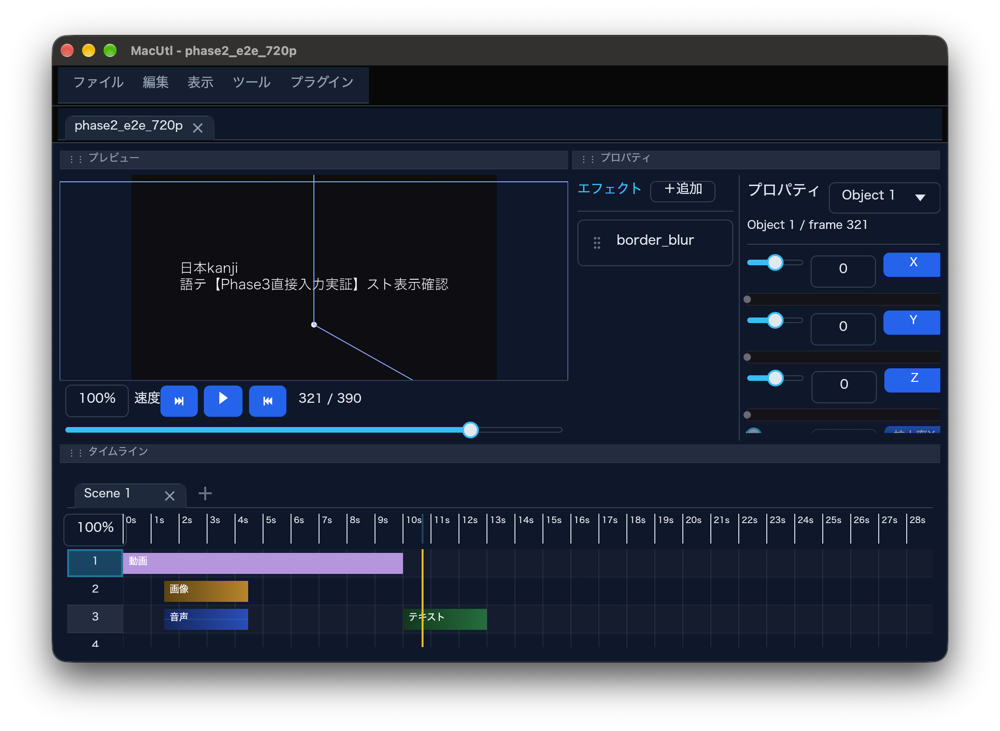

# MacUtl

**NeoUtl をベースに開発した、macOS ネイティブの AviUtl 風動画編集ソフトです。本家 AviUtl および NeoUtl の公式版・移植版ではありません（非公式フォーク）。**

- ベース: [NeoUtl](https://codeberg.org/taisho-guy/NeoUtl) v0.8.11（プレアルファ、コミット `0ead393`）
- 対応: Apple Silicon（arm64）のみ / macOS 27.0 以降
- ライセンス: AGPL-3.0-or-later
- 配布: [GitHub Releases](https://github.com/Ren9618/MacUtl/releases)



## MacUtl とは

MacUtl は、AviUtl ExEdit 風のタイムライン編集・プレビュー・書き出しを macOS 上で行えるようにした非公式フォークです。NeoUtl の Rust / wgpu 実装をベースに、macOS 向けの VideoToolbox ハードウェアデコード、日本語 IME 入力、`.app` パッケージング、Gatekeeper を考慮した配布形態を追加しています。

本家 AviUtl のプラグイン（`.auf` / `.aui` / `.auo` 等）とのバイナリ互換はありません。NeoUtl のオブジェクト／エフェクトプラグイン ABI を使用します。

### 現在できること（Phase 4.5 時点で実測済み）

- 起動、プロジェクト作成・保存・読み込み
- タイムライン編集、Undo / Redo
- プレビュー（VideoToolbox HW デコード、失敗時はソフトウェアにフォールバック）
- 日本語表示と IME による直接入力
- Objects 9 種 / Effects 23 種 / Decoders 3 種 / Easing 1 種の登録
- 720p / 1080p の H.264 MP4 書き出し（動画＋画像プロジェクトを含む）
- 音声プラグイン（VST3）のスキャン（実適用は未確認）

## 動作環境

| 項目 | 要件 |
|---|---|
| CPU | Apple Silicon（arm64）。Intel Mac / Universal2 は配布しません |
| OS | macOS 27.0 以降（実測値。同梱 FFmpeg 9.0.2 の dylib が `minos 27.0` のため） |
| 空き容量 | 約 100 MB（展開後） |

macOS 27.0 未満では、同梱 dylib のロードに失敗する可能性があります。Intel Mac では動作しません。

## インストール

1. [Releases](https://github.com/Ren9618/MacUtl/releases) から `MacUtl-0.8.11-macos.dmg` をダウンロードします。
2. DMG を開き、`MacUtl.app` を `Applications` フォルダへドラッグします。
3. `/Applications/MacUtl.app` を起動します。

### 初回起動（Gatekeeper）

本アプリは **ad-hoc 署名のみ** で、Apple Developer ID 署名・公証（notarization）は行っていません。そのため、初回起動時に Gatekeeper が「開発元を確認できません」と表示します。以下のいずれかで起動してください。

- Finder で `MacUtl.app` を **右クリック →「開く」** を選び、ダイアログで「開く」を押す（推奨）
- 一度起動を試したあと、**システム設定 → プライバシーとセキュリティ → セキュリティ** の「このまま開く」を押す
- ターミナルで隔離属性を外す:

  ```bash
  xattr -dr com.apple.quarantine /Applications/MacUtl.app
  ```

Gatekeeper をシステム全体で無効化する操作（`spctl --master-disable` 等）は推奨しません。ZIP 版を使う場合も同様の手順が必要です。

## 既知の制限

- ベースの NeoUtl が **プレアルファ** です。API・プロジェクト形式・UI は予告なく変わります。
- **Intel Mac 非対応**（arm64 thin のみ）。
- VST3 等の音声プラグインは **スキャン確認のみ** で、実際の音声処理への適用は未確認です。
- **自動更新はありません。** 新しい版は Releases から手動で取得してください。macOS では `.app` の自己置換がコード署名を壊すため、自動更新を無効化しています。
- Apple Developer ID 署名・公証が無いため、Gatekeeper の警告が出ます。
- 起動時にシステムフォントを一括プリロードするため、一時的にメモリ使用量が増えることがあります。
- 本家 AviUtl のプラグインとの互換性はありません。

## プライバシ

MacUtl は通常の編集・書き出し操作で外部サーバへデータを送信しません。

- クラッシュレポート（Sentry / GlitchTip）は **macOS では初期化されません**。上流の DSN 文字列はソースに残っていますが、macOS ビルドではコードレベルで無効化しています。
- 更新チェックは **macOS では無効** です。起動時に Codeberg の上流 API へ問い合わせることはありません。
- テレメトリ、利用統計、広告 SDK はありません。
- VST3 プラグインのスキャンはローカルのファイルシステムに対してのみ行います。
- ユーザーが README 内の外部リンクを開いた場合のみ、ブラウザがそのサイトへ接続します。

## ライセンス

MacUtl は **GNU Affero General Public License version 3 or later（AGPL-3.0-or-later）** で配布します。上流 NeoUtl の `LICENSE` と著作権表示を保持しています。

- [LICENSE](LICENSE) — AGPL-3.0 全文
- [LICENSE_AUDIT.md](LICENSE_AUDIT.md) — ライセンス本調査（Rust / FFmpeg / branding / フォント / AGPL チェックリスト）
- [THIRD_PARTY_NOTICES.md](THIRD_PARTY_NOTICES.md) — 全 Rust クレートと同梱ネイティブライブラリのライセンス
- [MACOS_CHANGES.md](MACOS_CHANGES.md) — 上流からの変更点と変更日
- [third_party/](third_party/) — FFmpeg 等のライセンス本文と対応ソース情報

本アプリには GPL-3.0-or-later の FFmpeg（Homebrew 9.0.2、`--enable-gpl --enable-version3`）と、GPL の x264 / x265 が同梱されています。GPLv3 §13 に基づき AGPLv3 と組み合わせて配布しています。完全なソースはこのリポジトリで公開しています。

### 上流へのクレジット

- NeoUtl: <https://codeberg.org/taisho-guy/NeoUtl>（AGPL-3.0-or-later）
- NeoUtl 公式サイト: <https://neoutl.taisho-guy.org>
- 上流 README: [README.upstream.md](README.upstream.md)
- 上流の履歴は書き換えず、`0ead393` の上にフォーク側の変更を積んでいます。

## サポート

- サポートは **GitHub Issues のみ** です: <https://github.com/Ren9618/MacUtl/issues>
- 非同期対応で、返信・修正・対応時期を保証しません。
- 上流 NeoUtl / Codeberg へ、このフォークの不具合を報告しないでください。
- 不具合報告には、macOS のバージョン、Mac の機種、再現手順、可能ならログを添付してください。

## ソースからビルド

### 必要なもの

- macOS 27.0 以降 / Apple Silicon
- Xcode Command Line Tools
- Rust 1.99.1 以降（`rustup` 推奨）
- Python 3
- Homebrew の FFmpeg 9.0.2（GPL ビルド。`--enable-gpl --enable-version3 --enable-libx264 --enable-libx265` を含むもの）
- `git`、`hdiutil`、`codesign`（macOS 標準）

### 手順

```bash
git clone --recurse-submodules https://github.com/Ren9618/MacUtl.git
cd MacUtl

# 依存関係を取得してビルド
cargo xtask build --release

# MacUtl.app / DMG / ZIP を生成
cargo xtask package --release
```

生成物:

- `target/bundle/MacUtl.app`
- `target/bundle/MacUtl-0.8.11-macos.dmg`
- `target/bundle/MacUtl-0.8.11-macos.zip`

サブモジュール（`assets` / `i18n` / `sdk` / `wiki`）は参照のまま維持しています。`--recurse-submodules` を忘れた場合は `git submodule update --init --recursive` を実行してください。

上流 `i18n` サブモジュールの固定コミットには、macOS 向けの日本語診断文言が一部含まれていません。リリース版と同一の表示でビルドする場合は、次のパッチを適用してください（必須ではありません。未適用の場合はキー文字列がそのまま表示されます）。

```bash
git -C i18n apply ../patches/i18n-macutl-ja.patch
```

### テスト

```bash
cargo fmt --all -- --check
cargo test --workspace --exclude NeoUtl
```

## 謝辞

- NeoUtl 開発チーム（taisho-guy 氏ほか）
- AviUtl 作者の KEN 氏、および ExEdit の作者の方々
- 依存クレート・FFmpeg・各コーデックの開発者

本プロジェクトは AviUtl からソースコードを流用したものではなく、NeoUtl のフォークとしてその成果物を利用しています。
